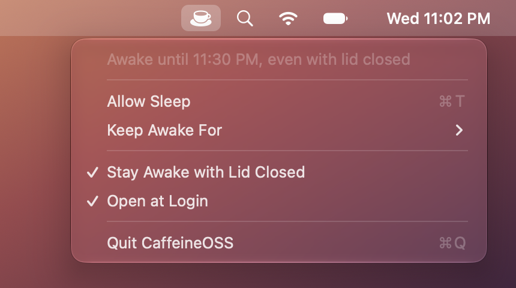
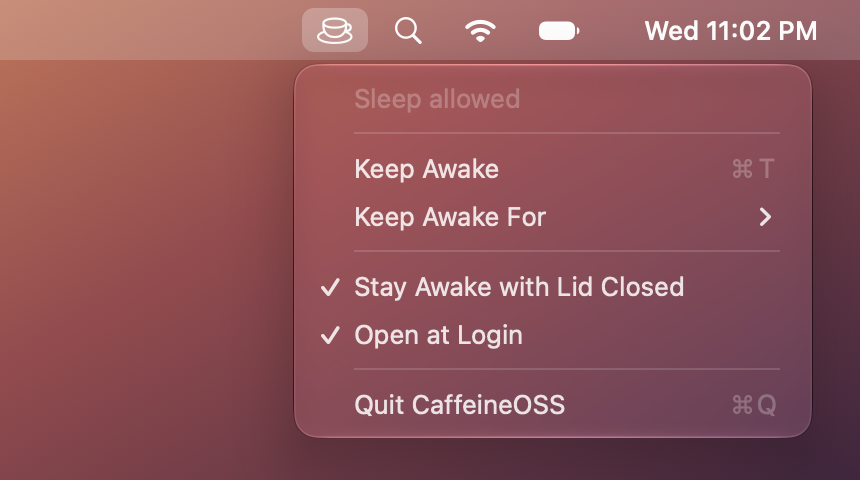

<p align="center">
  
</p>

<p align="center">
  <b>A tiny coffee cup in your menu bar that keeps your Mac awake — even with the lid closed.</b><br>
  <sub>Free · open source · macOS 13 and later · Apple silicon &amp; Intel</sub>
</p>

<p align="center">
  <a href="https://github.com/karimbacchus/caffeineOSS/releases/latest"><b>⬇︎ Download the latest version</b></a>
</p>

<p align="center">
  
</p>

## What it does

Leaving a download, a build, or an AI agent running? Click the cup and your Mac won't fall asleep until you say so.

| | |
|---|---|
| ☕ **One click** | Click the cup to turn it on or off. A filled cup means your Mac is staying awake. |
| ⏱ **Timers** | Right-click for 15 minutes up to 8 hours, then it switches itself off. |
| 💻 **Lid closed? Still awake.** | Close your laptop and it keeps working. The screen turns off so it doesn't burn power. |
| 🚀 **Open at Login** | One tick and it's always there when you start your Mac. |

<p align="center">
  <br>
  <sub>Outline cup: your Mac sleeps normally.</sub>
</p>

## Install

1. Download **CaffeineOSS.zip** from [Releases](https://github.com/karimbacchus/caffeineOSS/releases/latest).
2. Unzip it and drag **CaffeineOSS** into your Applications folder.
3. Open it — a cup appears in your menu bar.

The first time you use lid-closed mode, macOS asks for your password once. That's it.

<details>
<summary>Build it yourself instead</summary>

Needs the Xcode Command Line Tools (`xcode-select --install`):

```bash
git clone https://github.com/karimbacchus/caffeineOSS.git && cd caffeineOSS
./build.sh && open CaffeineOSS.app
```
</details>

## What's new in 2.0

- **Lid-closed mode is safer.** If the app crashes, your Mac can sleep normally again.
- **Password just once**, not every time you click.
- **Screen goes dark** when the lid is closed.
- **A proper menu**, with timers, live status and Open at Login.
- **Liquid Glass ready** for macOS 26 and 27, with a new app icon.
- **Signed and notarized**, so it opens without security warnings.

## Uninstall

Untick **Open at Login**, quit the app, and drag it to the Trash. To remove the one-time password permission too:

```bash
sudo rm /etc/sudoers.d/caffeineoss
```

---

<sub>Originally built by <a href="https://github.com/kuberwastaken/caffeineOSS">kuberwastaken</a> to get past a locked-down work laptop. Under the hood it uses the same tools as macOS's built-in <code>caffeinate</code> and <code>pmset</code>. MIT licensed.</sub>
